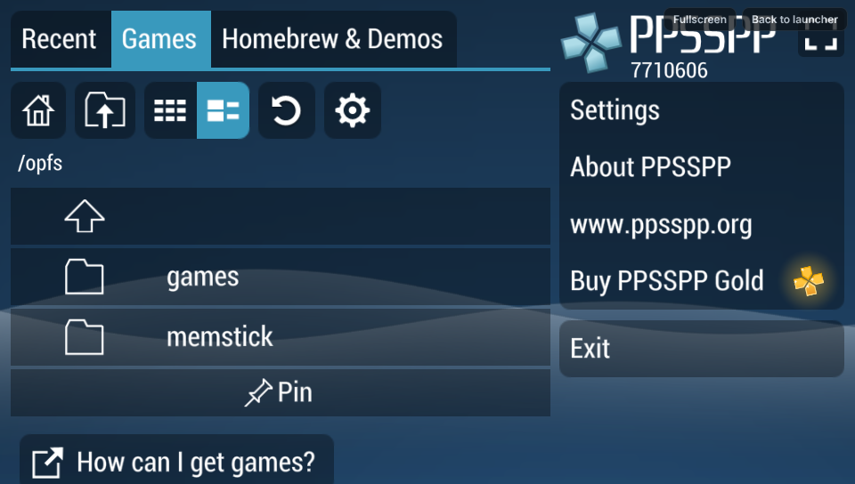

# PPSSPP Web

[PPSSPP](https://github.com/hrydgard/ppsspp) (the PSP emulator) compiled to WebAssembly and served
by a [Bun](https://bun.sh) server. You load your own game dump into the page; it is copied into the browser's
private storage (OPFS) once and booted from there. First target game: **Tekken 6**.

| PPSSPP's menu in the browser | `cube.iso` booted from browser storage, 60 fps |
|---|---|
|  |  |

## Run it

```sh
sh build.sh          # ~30-40 min the first time: Emscripten SDK, SDL3, PPSSPP at 7710606 + patches/
bun install
bun start            # http://localhost:8080  (bun --watch: bun run dev)
```

Then **Add game file…** (ISO, CSO or CHD), wait for the copy, and press **Play**.
Use current Chrome or Edge first; Firefox and Safari are untested so far. The page has to be served
with the COOP/COEP headers that `server.ts` sends, from `localhost` or HTTPS, or threads are disabled
and PPSSPP won't start.

## Playing

- **Keyboard** (PPSSPP's defaults): arrow keys = D-pad, I/J/K/L = analog stick, Z/X/A/S = Cross/Circle/Square/Triangle,
  Q/W = L/R, Space/Enter = Start/Select, Esc = pause menu, hold Tab = fast forward.
- **DualShock 4 / DualSense** (USB or Bluetooth, Chrome or Edge): works with no setup. Face buttons, D-pad and left
  stick map one to one, L1/R1 = L/R, Options = Start, Share/Create = Select, PS button or L2 = pause menu.
  Press any button once after plugging in so the browser exposes the pad. Remap in Settings → Controls.
- **F2** shows or hides the stats overlay; **Copy stats** copies it with your browser version, for reporting speed.

## Measuring speed (for Tekken 6)

1. Play, press **F2**, and note the overlay in a fight:
   `Game: <fps> fps · speed <n>%` (100% = full speed), `Threads: page / emulator Hz`, `Audio: ms buffered · silent frames`.
   Silent frames that keep rising mean the emulator can't keep up.
2. For a profile, build with `WASM_PROFILE=ON sh build.sh`, open Chrome DevTools → Performance, record 10 s of a
   fight, and look at the **Worker** track named after the emulator thread: the C++ function names show where time goes.

## How it works

- **CPU:** PPSSPP's IR interpreter (no JIT can run in WebAssembly). Emscripten is now its own
  architecture (`PPSSPP_ARCH_WASM32`) instead of pretending to be x86.
- **Threads:** the emulator runs on a pthread (a Web Worker). Once per animation frame the page's
  main thread handles input and replays the GL commands the emulator recorded, with WebGL2. It never
  waits for the emulator.
- **Files:** OPFS is mounted at `/opfs` with Emscripten's WASMFS before `main()` runs. Games go in
  `/opfs/games`; the memory stick (saves, settings) is `/opfs/memstick`, so both persist.
- **Memory:** PSP addresses are masked into one 256 MB block.
- **SIMD:** built with `-msimd128 -msse4.1`; Emscripten turns PPSSPP's SSE code into WebAssembly SIMD.
- **Video:** PPSSPP's bundled FFmpeg 3.0.2 (pure C) is compiled in, for PMF/MPEG cutscenes.
- **Audio:** a mixer thread calls PPSSPP's `NativeMix` and fills a ring buffer in WebAssembly memory; an AudioWorklet
  (`public/audio-worklet.js`) reads it through the shared memory on the browser's audio thread, ~50 ms ahead.
  SDL's own browser audio (a deprecated ScriptProcessorNode on the main thread) is not used.
- **Gamepads:** SDL3's built-in mapping for the browser's "standard" gamepad layout. On the web build, L1/R1 are sent
  as the buttons PPSSPP's default pad map expects for L/R (stock SDL builds need a manual remap for them).

## Status (20 Nov 2026)

| Check | Result |
|---|---|
| PSP CPU tests (pspautotests `cpu/`, headless in Node) | 38/61 pass. Native PPSSPP passes 41; the only differences are 3 FPU rounding-mode tests (WebAssembly has no rounding modes). The other 20 failures are upstream. |
| Speed, same CPU test run | WebAssembly 6.5 s vs native 3.3 s (same interpreter), roughly 2× slower |
| PSP GPU tests (`gpu/`, software renderer) | 104/114 pass |
| PSP video tests (`video/`, with FFmpeg) | 20/39 pass, the same 20 as native PPSSPP with FFmpeg (15 without FFmpeg) |
| SIMD on vs off | Same results in every suite; CPU and GPU suites ~6-10% faster |
| `build.sh` from a fresh clone | Works: patches apply to upstream `7710606`, and the output boots `cube.iso` at 60 fps |
| PPSSPP UI in headless Chromium | Works, 60 fps |
| Audio (AudioWorklet) | Consumes audio in real time (2.97 s in ~3 s), ~50 ms buffered, 0 gaps after boot |
| Simulated DualShock 4 (Chrome's id, standard mapping) | `controller.pbp` reports L, R, Cross, Triangle, Start and Up correctly |
| Import → OPFS → boot an ISO | Works (`pspautotests/demos/cube.iso`, 60 fps on a software GPU) |
| Tekken 6 | Not tried yet: needs your own dump |

## Bugs fixed on the way (all in `patches/ppsspp-wasm.patch`)

1. Emscripten was treated as x86, so the x86 JIT would be used. Added a WebAssembly architecture.
2. `sleep` used `emscripten_sleep`, which needs Asyncify. Pthreads can use `usleep`.
3. **Memory corruption:** with `NO_MMAP` PPSSPP reserved 160 MB for PSP memory, but masked
   addresses reach 256 MB (64 MB Slim RAM ends at `0x0C000000`). Writes past the end overwrote the
   heap, including thread structures. Now 256 MB, allocated once.
4. **Frozen at the intro screen:** browsers report a 0 Hz refresh rate, and the menu frame limiter
   computed `1/0` → a sleep of ~35 minutes. Found by pausing the workers through the Chrome DevTools
   protocol (`tools/stacks.js`).
5. Browser main loop for the SDL frontend, non-blocking GL replay, OPFS mount, build fixes for
   armips, OpenXR headers, ad hoc networking sockets and missing includes.

## Next for Tekken 6

1. Load your Tekken 6 dump; turn on **Settings → Graphics → Show FPS counter** and note the speed in
   menus and in a fight. PPSSPP's compat list already sets `RequireDefaultCPUClock` and
   `ForceMax60FPS` for it.
2. If it's slow: profile with Chrome DevTools, then
   - tune the IR passes for the hottest blocks,
   - later, a JIT that compiles PSP code to WebAssembly modules.
3. SDL3_ttf for nicer UI text.

## Runtime

- **Server:** Bun 1.4 (`Bun.serve` in `server.ts`, no dependencies). It sets COOP/COEP/CORP on every
  response, serves `.wasm` as `application/wasm`, and only serves files inside `public/`.
- **Browser tests** (`tools/*.js`, Playwright + Chromium) run under Bun too: `bun tools/boot.js <file>`.
- **Exception: the headless PSP test runner** (`PPSSPPHeadless.js`, built with `-sENVIRONMENT=node`)
  still needs **Node.js**. Under Bun 1.4 it hangs before its first output: Emscripten's Node runtime
  starts pthreads with `worker_threads` and blocks on `Atomics.wait`, which Bun's Node compatibility
  doesn't handle yet. Run it with `node build-wasm/PPSSPPHeadless.js ...`.

## Tools

- `tools/boot.js <file>`: imports a file through the page in headless Chromium, boots it, prints frame counters, screenshots.
- `tools/smoke2.js`: opens the PPSSPP menu and prints frame counters.
- `tools/controller.js <controller.pbp>`: holds buttons on a simulated DualShock 4 and checks audio keeps flowing.
- `tools/input-audio.js`: checks the menu reacts to the simulated pad and the stats overlay.
- `tools/stacks.js`: pauses every worker and prints its call stack (build with `WASM_DEBUG=ON`).

PPSSPP is GPL-2.0-or-later, and so is this folder's patch set. Never commit or host game files.
