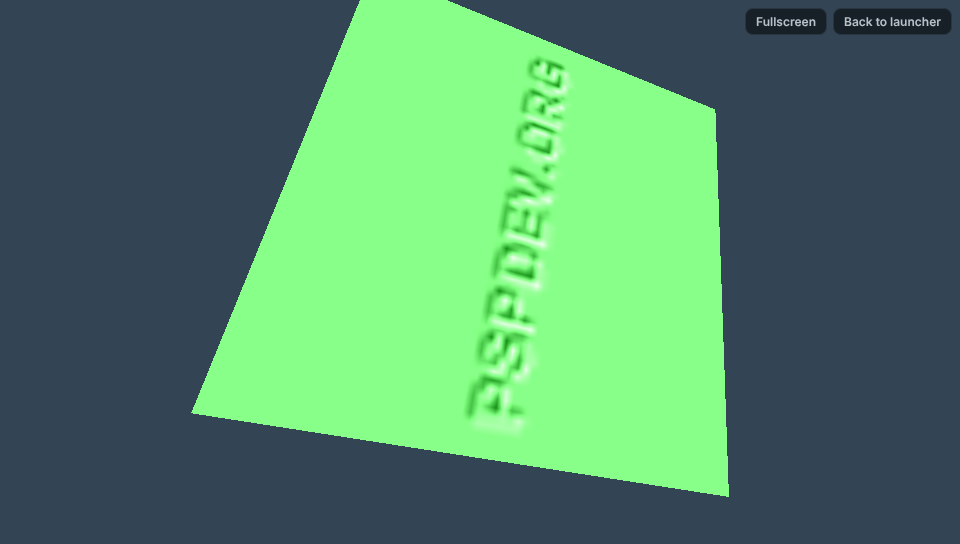

# PPSSPP Web

[PPSSPP](https://github.com/hrydgard/ppsspp) (the PSP emulator) compiled to WebAssembly and served
by a [Bun](https://bun.sh) server. The **server provides the games**: players open the page, the games are
downloaded into their browser's storage (OPFS) once, and the page shows them as a library (titles and art read from
each disc). Picking a game boots it directly; PPSSPP's own menu is skipped.
Players can't add files. First target game: **Tekken 6**.

| PPSSPP's menu in the browser | `cube.iso` booted from browser storage, 60 fps |
|---|---|
|  |  |

## Run it

```sh
sh build.sh          # ~30-40 min the first time: Emscripten SDK, SDL3, PPSSPP at 7710606 + patches/
cp /path/to/Tekken6.iso memstick/ISO/   # games go on the server's memory stick
bun install
bun start            # http://localhost:8080  (bun --watch: bun run dev)
```

Open the page, wait for the game's card to say **Ready**, and click it (or **Play** in the top bar for the last game
played). `?menu` opens PPSSPP's own menu instead, with no game; the menu test tools use it.

### Games on the server

`memstick/` (or `MEMSTICK_DIR`) uses the PSP memory stick layout. Only two folders are sent to players:

| Server folder | Shows up in PPSSPP as |
|---|---|
| `memstick/ISO/` (`.iso`, `.cso`, `.chd`) | **Games** tab |
| `memstick/PSP/GAME/<name>/EBOOT.PBP` | **Homebrew & Demos** tab |

- On each visit the page fetches `memstick/manifest.json` and downloads only new or changed files
  (by size and modification time). A worker writes each file in place in OPFS and saves every 64 MB,
  so a closed tab resumes where it stopped. Files you delete on the server are deleted from players' storage too.
- Players' saves and settings (`PSP/SAVEDATA`, `PSP/SYSTEM`, ...) stay in their own browser and are never
  synced or overwritten. Nothing else on the server's memory stick is served.
- In PPSSPP, the Games tab is fixed to `ms:/ISO`: no browsing to other folders, no upload, pin, store,
  "how to get games" links or Exit button. Settings stay available.
- Game files are git-ignored. Only host games you have the right to share, and put the server behind a password
  if it's reachable from the internet.
Use current Chrome or Edge first; Firefox and Safari are untested so far. The page has to be served
with the COOP/COEP headers that `server.ts` sends, from `localhost` or HTTPS, or threads are disabled
and PPSSPP won't start.

## Playing

- **Keyboard** (PPSSPP's defaults): arrow keys = D-pad, I/J/K/L = analog stick, Z/X/A/S = Cross/Circle/Square/Triangle,
  Q/W = L/R, Space/Enter = Start/Select, Esc = pause menu, hold Tab = fast forward.
- **DualShock 4 / DualSense** (USB or Bluetooth, Chrome or Edge): works with no setup. Face buttons, D-pad and left
  stick map one to one, L1/R1 = L/R, Options = Start, Share/Create = Select, PS button or L2 = pause menu.
  Press any button once after plugging in so the browser exposes the pad. Remap in Settings → Controls.
- **F2** shows or hides the stats overlay (hidden by default); **Copy stats** copies it with your browser version, for reporting speed.

## Measuring speed (for Tekken 6)

1. Play, press **F2**, and note the overlay in a fight:
   `Game: <fps> fps · speed <n>%` (100% = full speed), `Threads: page / emulator Hz`, `Audio: ms buffered · silent frames`.
   Silent frames that keep rising mean the emulator can't keep up.
2. For a profile, build with `WASM_PROFILE=ON sh build.sh`, open Chrome DevTools → Performance, record 10 s of a
   fight, and look at the **Worker** track named after the emulator thread: the C++ function names show where time goes.

## How it works

- **CPU:** PPSSPP's IR interpreter (no JIT can run in WebAssembly). Emscripten is now its own
  architecture (`PPSSPP_ARCH_WASM32`) instead of pretending to be x86.
- **Threads:** the emulator runs on a pthread (a Web Worker). Once per animation frame the page's
  main thread handles input and replays the GL commands the emulator recorded, with WebGL2. It never
  waits for the emulator.
- **Files:** OPFS is mounted at `/opfs` with Emscripten's WASMFS before `main()` runs. Games go in
  `/opfs/games`; the memory stick (saves, settings) is `/opfs/memstick`, so both persist.
- **Memory:** PSP addresses are masked into one 256 MB block.
- **SIMD:** built with `-msimd128 -msse4.1`; Emscripten turns PPSSPP's SSE code into WebAssembly SIMD.
- **Video:** PPSSPP's bundled FFmpeg 3.0.2 (pure C) is compiled in, for PMF/MPEG cutscenes.
- **Audio:** a mixer thread calls PPSSPP's `NativeMix` and fills a ring buffer in WebAssembly memory; an AudioWorklet
  (`public/audio-worklet.js`) reads it through the shared memory on the browser's audio thread, ~50 ms ahead.
  SDL's own browser audio (a deprecated ScriptProcessorNode on the main thread) is not used.
- **Gamepads:** SDL3's built-in mapping for the browser's "standard" gamepad layout. On the web build, L1/R1 are sent
  as the buttons PPSSPP's default pad map expects for L/R (stock SDL builds need a manual remap for them).

## Status (20 Nov 2026)

| Check | Result |
|---|---|
| PSP CPU tests (pspautotests `cpu/`, headless in Node) | 38/61 pass. Native PPSSPP passes 41; the only differences are 3 FPU rounding-mode tests (WebAssembly has no rounding modes). The other 20 failures are upstream. |
| Speed, same CPU test run | WebAssembly 6.5 s vs native 3.3 s (same interpreter), roughly 2× slower |
| PSP GPU tests (`gpu/`, software renderer) | 104/114 pass |
| PSP video tests (`video/`, with FFmpeg) | 20/39 pass, the same 20 as native PPSSPP with FFmpeg (15 without FFmpeg) |
| SIMD on vs off | Same results in every suite; CPU and GPU suites ~6-10% faster |
| `build.sh` from a fresh clone | Works: patches apply to upstream `7710606`, and the output boots `cube.iso` at 60 fps |
| PPSSPP UI in headless Chromium | Works, 60 fps |
| Audio (AudioWorklet) | Consumes audio in real time (2.97 s in ~3 s), ~50 ms buffered, 0 gaps after boot |
| Simulated DualShock 4 (Chrome's id, standard mapping) | `controller.pbp` reports L, R, Cross, Triangle, Start and Up correctly |
| Server memstick → OPFS → game list → boot | Works (`cube.iso`: first visit downloads, second downloads nothing, server-side delete/change pruned/re-fetched) |
| Tekken 6 (`ULUS-10466`), 23 Nov 2026 | **Plays.** Boots to the autosave notice in ~1 s, then Bandai Namco logo, opening movie (FFmpeg), title, menus, Arcade, VS screen and a full fight with correct graphics; audio streams with no gaps (not listened to). Menus at 100% speed. In fights 35-40% speed here, but this test machine has no GPU (Chromium draws with SwiftShader on 4 shared CPU cores and the page thread is the bottleneck); real numbers need a real GPU. |
| 816 MB game sync | ~5 s from a local server; a download closed at 304 MB resumes and the stored file matches the server's |

## Bugs fixed on the way (in `patches/ppsspp-wasm.patch` unless noted)

1. Emscripten was treated as x86, so the x86 JIT would be used. Added a WebAssembly architecture.
2. `sleep` used `emscripten_sleep`, which needs Asyncify. Pthreads can use `usleep`.
3. **Memory corruption:** with `NO_MMAP` PPSSPP reserved 160 MB for PSP memory, but masked
   addresses reach 256 MB (64 MB Slim RAM ends at `0x0C000000`). Writes past the end overwrote the
   heap, including thread structures. Now 256 MB, allocated once.
4. **Frozen at the intro screen:** browsers report a 0 Hz refresh rate, and the menu frame limiter
   computed `1/0` → a sleep of ~35 minutes. Found by pausing the workers through the Chrome DevTools
   protocol (`tools/stacks.js`).
5. **Big games never finished syncing (page side, `public/`):** each 64 MB piece was saved by closing an
   OPFS writable stream, and Chrome copies the whole file on every close. For an 816 MB ISO that is
   gigabytes of copying; the download stalled and Bun closed the idle connection after 10 s. Now a
   worker (`sync-worker.js`) writes in place with a sync access handle, retries with Range requests,
   and the server's idle timeout is 120 s. Sync state is now `.sync-state-v2.json`, so every browser
   downloads its games once more, replacing any incomplete copy the old code left behind.
6. **Black screen on Macs (Chrome and Brave):** SDL asks for an 8-bit alpha channel by default, so the
   WebGL canvas was translucent, and PPSSPP leaves the backbuffer's alpha at 0. A GPU compositor shows
   such a canvas as fully transparent (black page behind it); headless Chromium's software compositor
   still showed the colours, which hid it from the tests. The canvas is now opaque (`SDL_GL_ALPHA_SIZE`
   0), and `tools/boot-game.js` tests on a white page so a transparent canvas shows up as white.
   The web build also offers only FIFO presentation, so the main loop always stays on
   `requestAnimationFrame` (vsync off used to switch it to `setTimeout`).
7. If PPSSPP aborts after Start, the page goes back to the launcher with the error in the log instead of
   leaving a black screen.
8. Browser main loop for the SDL frontend, non-blocking GL replay, OPFS mount, build fixes for
   armips, OpenXR headers, ad hoc networking sockets and missing includes.

## Next for Tekken 6

1. Measure on real hardware (M1 Pro, i5-10500H + GTX 1650): play a fight with the stats overlay on
   (F2) and send **Copy stats**. PPSSPP's compat list already sets `RequireDefaultCPUClock` and
   `ForceMax60FPS` for it.
2. If it's slow: profile with Chrome DevTools, then
   - tune the IR passes for the hottest blocks,
   - later, a JIT that compiles PSP code to WebAssembly modules.
3. SDL3_ttf for nicer UI text.

## Hosting: app on Vercel, games in a private Supabase bucket

The app (`public/` + `public/build/`) is static, so it runs on Vercel
(`tools/vercel-branch.sh` puts it on the `vercel-web` branch with the COOP/COEP headers). Games never
go to Vercel. They live in a **private** Supabase Storage bucket, `ppsspp-games`, in the same layout
as `memstick/` (`ISO/`, `PSP/GAME/`, `PSP/TEXTURES/`, `PSP/SYSTEM/<GAMEID>_ppsspp.ini`).

- The free plan caps files at 50 MB, so big files are stored as `<name>.part000`, `.part001`, ...
  (`split -b 48M -d -a 3 game.iso game.iso.part`). Free also means 1 GB storage and ~10 GB of
  downloads a month for the whole organisation: roughly 6 to 12 full downloads of an 816 MB game.
- The Edge Function `supabase/functions/games` (deployed with JWT verification off) checks the games
  key (`Authorization: Bearer <key>`) and returns the manifest with
  6-hour signed links for each part. Only the Vercel origin and `http://localhost:8080` may call it
  from a browser. The key is the `GAMES_KEY` Edge Function secret, or, if that isn't set, the key whose
  SHA-256 is stored in `public.ppsspp_settings` (row `games_key_sha256`; row-level security on, no
  policies, so only the function reads it). To change the key without the dashboard:
  `update public.ppsspp_settings set value = encode(sha256('<new key>'), 'hex') where name = 'games_key_sha256';`
- The page asks players for the key once, downloads the parts straight from Storage and joins them in
  browser storage. Build the Vercel branch with
  `MANIFEST_URL=https://<project>.supabase.co/functions/v1/games sh tools/vercel-branch.sh`.

Your own `server.ts` can serve games the same way: `GAMES_KEY=... ALLOWED_ORIGINS=<app origin> bun start`,
and `GAMES_SERVER=<its https URL>` for `tools/vercel-branch.sh`.

## Texture packs from GitHub (`tools/remote_pack.py`)

A pack published on GitHub (for Tekken 6, [Kharij's HD Texture Pack](https://github.com/kharij/Tekken-6-HD-Texture-Pack),
whose author distributes it only on GitHub and the PPSSPP forums) is served to players straight from
GitHub instead of from our bucket. `python3 -I tools/remote_pack.py <clone> ULUS10466 out.json` lists
its files and sizes, pinned to the clone's commit; upload the JSON to the bucket as
`remote/<name>.json` and the games function lists every file under `PSP/TEXTURES/<GAMEID>/` with a
`raw.githubusercontent.com` link (CORS and Range supported). A remote pack replaces anything in the
bucket for the same game folder. The page downloads with 24 parallel worker threads for packs of many small files (measured: 110 s for the 524 MB Tekken pack, against 207 s with 6 and 175 s with 48), 4 for big files.

Downloads are cached in each player's browser storage: a file is fetched again only when the
server's copy changes. Finished files are marked done and the whole list is fingerprinted, so a
return visit to an unchanged server checks nothing per file (about 4 s to ready with 8,651 files,
and no downloads). Clearing site data, or the browser evicting storage when the disk is nearly
full, means downloading again; the page asks for persistent storage to make eviction unlikely.

## HD texture packs (`tools/texture_pack.py`)

PPSSPP replaces a game's textures with files from `PSP/TEXTURES/<GAMEID>/` (or a `textures.zip`
there), matched by hash name. The server and the Supabase bucket sync that folder to players.

1. Dump: set `SaveNewTextures = True` under `[Graphics]` in the game's `PSP/SYSTEM/<GAMEID>_ppsspp.ini`
   and play; PPSSPP writes `PSP/TEXTURES/<GAMEID>/new/<hash>.png`. (Do this on a test browser profile:
   the game sync prunes `PSP/TEXTURES` to what the server has, so dumps in a player's browser vanish.)
2. Upscale: `pip install torch spandrel pillow numpy` (CPU wheels: `--index-url
   https://download.pytorch.org/whl/cpu`), get Real-ESRGAN weights (e.g. Hugging Face
   `ai-forever/Real-ESRGAN`, `RealESRGAN_x4.pth`), then
   `python tools/texture_pack.py <new dir> RealESRGAN_x4.pth <pack dir> [--zip]`.
   It keeps file names, upscales alpha separately, skips tiny, single-colour and render-target-sized
   images, and writes `textures.ini`.
3. Ship: copy the pack into `memstick/PSP/TEXTURES/<GAMEID>/` (and the bucket's `PSP/TEXTURES/...`).

The pack is derived from the game: keep it out of git and only give it to people who own the game.

## Mapping a game's code (`tools/psp_map.py`)

Builds a map of a PSP game from its *decrypted* executable: module info, every imported system
function (named from PPSSPP's HLE tables), functions found from call instructions, strings, C++ class
names recovered from RTTI, and the disc's files. Its output is derived from the game: keep it out of
git and don't share it.

1. Dump the decrypted executable: in PPSSPP (desktop, or this web build via the game's
   `PSP/SYSTEM/<GAMEID>_ppsspp.ini` with `[General]` `DumpFileTypes = 1`), boot the game once. It lands in
   `PSP/SYSTEM/DUMP/<GAMEID>_EBOOT.BIN`.
2. `pip install capstone pycdlib`, then
   `python3 -I tools/psp_map.py <GAMEID>_EBOOT.BIN <ppsspp source dir> <out dir> [game.iso]`.

For decompiled C, load the same file into Ghidra with the
[ghidra-allegrex](https://github.com/kotcrab/ghidra-allegrex) processor module (it also decodes the
Allegrex VFPU vector instructions that a plain MIPS disassembler can't).

## Runtime

- **Server:** Bun 1.4 (`Bun.serve` in `server.ts`, no dependencies). It sets COOP/COEP/CORP on every
  response, serves `.wasm` as `application/wasm`, and only serves files inside `public/`.
- **Browser tests** (`tools/*.js`, Playwright + Chromium) run under Bun too: `bun tools/server-sync.js memstick`.
- **Exception: the headless PSP test runner** (`PPSSPPHeadless.js`, built with `-sENVIRONMENT=node`)
  still needs **Node.js**. Under Bun 1.4 it hangs before its first output: Emscripten's Node runtime
  starts pthreads with `worker_threads` and blocks on `Atomics.wait`, which Bun's Node compatibility
  doesn't handle yet. Run it with `node build-wasm/PPSSPPHeadless.js ...`.

## Tools

- `tools/server-sync.js <memstick-dir>`: first visit, repeat visit, then server-side delete and change; screenshots the game list.
- `tools/boot-game.js ISO/<file> [outdir] [seconds] [keys]`: boots a server game directly with `?boot=`,
  presses keys on a schedule (e.g. `'[[15,"z"],[40,"Space"]]'`), saves a screenshot and the stats every 5 s, and the console log.
- `tools/remote_pack.py`: list a GitHub-hosted texture pack for players to download from GitHub (see above).
- `tools/texture_pack.py`: HD texture pack from dumped textures with Real-ESRGAN (see above).
- `tools/psp_map.py`: map of a PSP game's code and disc as JSON and CSV (see above).
- `tools/vercel-branch.sh`: puts the static web build (no games) on the `vercel-web` branch for Vercel.
- `tools/smoke2.js`: opens the PPSSPP menu and prints frame counters.
- `tools/input-audio.js`: checks the menu reacts to the simulated pad and the stats overlay.
- `tools/stacks.js`: pauses every worker and prints its call stack (build with `WASM_DEBUG=ON`).

PPSSPP is GPL-2.0-or-later, and so is this folder's patch set. Never commit or host game files.
